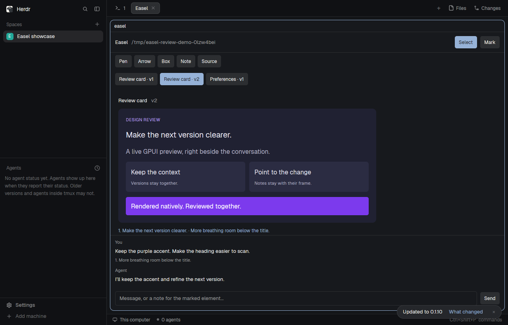

# Easel for Herdr

A native GPUI artifact review pane: versions, source, annotations and agent chat
inside **stock Herdr**. No custom Herdr build or replacement layout is needed.



[RECIPE.md](RECIPE.md) is the brief for rebuilding this experience from an empty
folder. `mods/easel/` is one working build. The supporting Rust source is included
so installation does not depend on access to the private Easel development repo.

## Before installing

The mod executes a local helper and reads/writes `.gpui-artifacts/` in the project
you choose. Approved compilation uses a local Cargo cache, may fetch crate
packages, and runs a separate program. Normal communication uses private local
Unix sockets. Linux is tested; Windows is not supported by this helper.

## Install

Install Rust and Python 3, with Herdr's CLI on PATH, then:

```sh
git clone https://github.com/yycholla/herdr-easel-mod.git
cd herdr-easel-mod
python3 scripts/install-herdr-mod.py
```

The installer builds `gpui-artifacts-mod` and `gpui-artifacts-mcp`, copies only
`main.js`, `renderer.js` and `mod.json` into your Herdr mod home, and creates CLI
links under `~/.local/bin`. It refuses a differing existing mod rather than
replacing your copy. `HERDR_APP_HOME`, `XDG_CONFIG_HOME`, and `EASEL_BIN_DIR` select
other destinations. Keep this checkout while its CLI symlinks are installed.

There is no `layouts/` folder or `keys.json` snippet. The mod uses the input's
Enter key; it does not require global shortcuts or change existing bindings.

Configure `~/.local/bin/gpui-artifacts-mcp` as a stdio MCP server in your agent.
Forward `HC_TERMINAL_ID` / `REX_BLOCK` so it can open beside its own terminal;
for Codex's MCP entry, include those names in `env_vars`. Reconnect existing MCP
sessions after an update. The MCP process's working directory selects its
project; `GPUI_ARTIFACTS_PROJECT` can override it.

To open a standalone mod tab manually, use a real absolute project directory:

```sh
herdr-app do tab.new '{"name":"Easel","mod":"easel","props":{"project":"/absolute/project"}}'
```

Ask your agent to call `render_gpui`. Normal interpreted previews stay in the
mod. Callback-heavy snippets may need the person's Compile and run approval;
compiled previews then open separately. A separately installed native Easel
viewer is optional and is not bundled here. PNG export and annotated screenshots
require that viewer; this mod does not claim to capture frames.

## Package

```text
mods/easel/     the shareable Herdr mod
RECIPE.md      the build-from-scratch brief
preview.png    an actual stock-Herdr sandbox screenshot
crates/        interpreter, protocol, compiler, backend and MCP server
scripts/       installer and independent checks
fixtures/      sample artifacts used by the checks
```

Do not copy `RECIPE.md` or `preview.png` into Herdr's mod directory. If the `easel`
name is occupied, follow the recipe's rename instructions and rebuild the MCP
server's matching mod name; do not overwrite the existing mod.

## Check

```sh
cargo test --locked
cargo build --locked -p easel-mod -p easel-mcp
python3 scripts/test-herdr-mod.py
herdr-app check mods/easel
```

The smoke script uses temporary projects and a fake host for routing, then checks
real fixtures with Herdr's hidden-window checker. It does not manipulate the real
window. For the full UI test, point the following variables at an upstream Herdr
checkout and binary; its sandbox needs Weston, Xwayland, uv and ImageMagick:

```sh
HERDR_ORIGIN_WORKTREE=/path/to/herdr-app \
HERDR_ORIGIN_BIN=/path/to/stock/herdr-app \
python3 scripts/test-herdr-mod-ui.py
```

The mod was checked against upstream Herdr `07ba77e` (0.1.10). Your host's generated
`.d.ts` files remain authoritative. This is a preview/review tool, not a full Rust
runtime inside a Herdr pane. See the recipe for supported behavior and limits.

Licensed under MIT OR Apache-2.0; see the license files and NOTICE.
