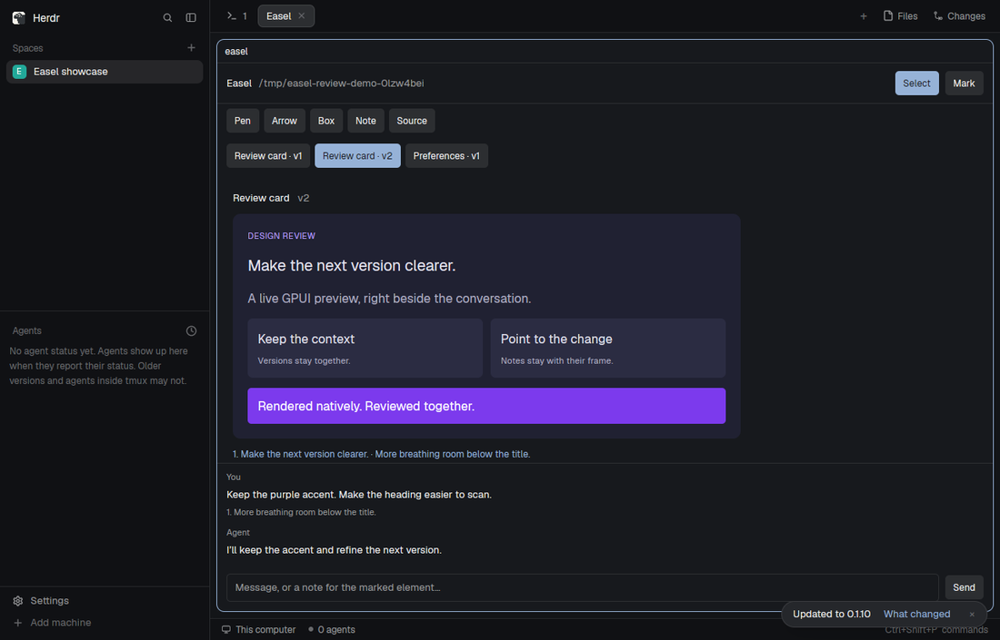

# Easel

A native GPUI review pane beside a coding agent's terminal. The person sees the
agent's rendered interface, switches between its versions, marks an element or
draws feedback, and sends a message back without leaving Herdr. The surrounding
controls follow Herdr's theme; the artifact keeps its own colors and requested
size. This is a mod for the person's current window, not a replacement layout.



## What you see

From top to bottom:

- A full-width pane with a 13px interface, the theme's surface background and
  foreground text. It has no fixed outer width or height and can be split,
  zoomed, moved and closed using Herdr's normal pane controls.
- A header padded 12px horizontally and 10px vertically. The bold “Easel” name
  sits left, a muted project path fills the middle and truncates, and Select
  and Mark buttons sit right. A 1px theme-border line separates it from below.
- A second toolbar, with 6px gaps and padding: Pen, Arrow, Box, Note and Source.
  Buttons have 12px labels, 10px horizontal/6px vertical padding and 5px corners.
  The selected tool uses the accent background and background-colored text;
  other buttons use the raised background and foreground text.
- When connecting fails, a visible error row and Reconnect button below the
  toolbars. When no artifacts exist, the canvas says to render GPUI from the
  agent to start a canvas here.
- A horizontally scrolling strip of version buttons, labeled with each
  artifact's title and version number. New versions keep old ones available.
- The main canvas fills the remaining height and scrolls in both directions.
  Give its contents 20px padding and 10px vertical gaps. A small heading shows
  the selected artifact's title and muted version number. Below it is the
  preview: its requested width/height, otherwise content-sized with a 300px
  minimum width. Do not scale the preview down to fit the pane. Use 16px as
  its inherited text size and Herdr's background/foreground as defaults;
  explicit artifact colors and styles win. Notes appear as numbered text
  beneath the frame; standalone notes use an accent border and 12px padding.
- A scrolling chat history beneath the canvas, at most 190px high, separated
  by a border. Show You, Agent or Easel in small muted type above each message,
  and include a short numbered description of each attached annotation.
- A horizontal strip of removable draft-annotation chips when drafts exist.
  When marking, show which artifact/version/element the note concerns, with a
  Cancel button. At the bottom, a 36px-high text input and Send or Add note
  button sit in a row with 12px outer padding and an 8px gap.

The preview is actual GPUI elements, not a screenshot, HTML or a web view. The
published preview depicts a sample artifact and review conversation, not content
that every installation must start with. Bring no custom fonts or image assets.

## How it behaves

Selecting an artifact version changes the preview and preserves the other
versions. A newly received version becomes selected. Source toggles between the
preview and a read-only Rust editor; its label becomes Preview while source is
shown. Tool and version buttons fade to 85% opacity on hover.

Select leaves the preview alone. Mark lets a click choose a particular element;
then the text input becomes an element note. Enter or Add note saves the draft
with its artifact ID, version, child-index path, source anchor and click position.
Cancel abandons the pending selection. Note creates a numbered general note for
the selected frame. These notes are listed beneath the frame, not draggable
sticky cards.

Pen records a stroke, Arrow records its endpoints, and Box records opposite
corners. Draw with the left mouse button over the preview; mouse-up or leaving
the frame finishes the gesture. Paint 2px accent-colored paths over the preview.
Coordinates remain relative to the artifact's original frame. The canvas scrolls;
there is no free-board panning, camera zoom or artifact dragging in this mod.

The input's Enter key sends a chat message unless an element/general note is
being written, when it adds that note instead. Send can also submit draft
annotations without message text. Draft chips remove only unsent annotations.
Sent annotations remain associated with the message and frame version. Agent
replies appear in the same history. Feedback contains text, anchors and drawing
coordinates, not a captured image.

The four Herdr agent statuses—working, blocked, done and idle—do not change this
pane: it does not list agents or read their status. Artifact states are separate:
rendered shows the native preview; invalid shows diagnostics; awaiting approval
shows the reason plus Compile and run and Decline; building shows that state;
running says the compiled preview is running; build failed shows compiler
errors; exited shows its exit code and available stderr; declined shows that it
was declined. Only the person's Compile and run click launches submitted code.
That preview opens in a separate native window. Source stays available for
inspection. There is no script-driven redraw timer or fake progress animation.

A missing/unreachable helper is an inline error, not a silent blank pane.
Reconnect retries the connection. Switching away from the tab keeps its copy
alive. Closing its pane releases its backend lease; a closed or crashed copy
must not keep an idle backend alive forever. Existing unrelated panes, keys,
layouts and settings stay intact.

## Built from

Create one mod named `easel`, with no layout file:

```text
mods/easel/
  mod.json       { "place": "none" }
  main.js        View, controls, per-copy connection and gesture state
  renderer.js    evaluated GPUI IR -> gpui-kit builders
```

The mod default-exports a `View`. Use `div`, `image`, `svg`, `PathBuilder` from
`gpui-kit`; flex helpers, `InputState`/`Input`, `EditorState`/`Editor` from
`gpui-base`; and `exec`, `props`, `theme` from `herdr`. Consult the installed
`.d.ts` files for the host's exact API. The app supplies ordinary pane framing;
no shipped mod is copied or patched, and no `layouts/` folder is created.

Props are `project` (an absolute local project directory, required) and `helper`
(the backend executable, default `gpui-artifacts-mod`). Each copy creates a
unique lease ID. Start slow work inside `cx.spawn`, take a fresh callback `cx`
and notify only when visible state changes. Closing a copy calls the helper's
close action directly. There are no custom key bindings and no keys.json
snippet; Enter is the text input's own submit behavior.

Provide a display-independent helper, `gpui-artifacts-mod`, and a stdio MCP
server, `gpui-artifacts-mcp`. They may be implemented in Rust independently of
Herdr. Use a parser such as `syn` to interpret a declarative subset of Rust
GPUI builders; never evaluate the submitted source as JavaScript. An evaluated
IR has text nodes or element nodes with div/image/SVG kind, builder calls with
typed arguments, children and source locations. Map its builders to the host's
supported calls, scope element/group IDs to artifact/version, resolve relative
asset paths against the project, and report unknown calls visibly. Use GPUI
`gpui-pre = 0.3.8` for interpretation tables and compiled preview compatibility.

The helper has these CLI entry points:

```sh
gpui-artifacts-mod start /absolute/project
gpui-artifacts-mod serve /absolute/project
gpui-artifacts-mod call /absolute/project '{"action":"ping"}'
```

One project owns one user-private Unix protocol socket and a second UI socket.
Use a stable hash of the canonical project path beneath XDG_RUNTIME_DIR, with a
supported explicit socket override. Never unlink a live socket or steal a
project from another host. The UI request is one JSON line; its actions include
open, close, ping, watch, select, annotate, remove_annotation, send, render_error,
approve and decline. Include the lease in UI calls. Watch takes a revision and
blocks until a change or a 25-second timeout; its snapshot includes revision,
project, frames, selected version, messages, markers, drawings, notes and drafts.
Each frame includes summary (ID/title/version/mode/status), evaluated tree,
requested dimensions and source. Keep this comfortably within Herdr's 30-second
exec limit; do not replace it with rapid polling.

The protocol socket accepts ping, upsert, get, list, chat, say, export and
activate requests. Export returns an explicit unsupported error in this host.
Expose MCP tools render_gpui, get_gpui_artifact, list_gpui_artifacts,
await_user_message, send_chat_message and export_gpui_png. Re-rendering an ID
creates a new version. Auto interprets supported code and offers compilation
for unsupported builders; Interpret reports diagnostics instead of compiling;
Compile requests approval before any execution. Keep callback-heavy arbitrary
Rust out of interpreted previews.

Persist in the selected project's `.gpui-artifacts/`: immutable versioned Rust
source under `artifacts/<hex-encoded-id>/v<number>.rs` and an atomically replaced
format-1 `state.json`. Preserve unknown fields when updating an existing canvas.
Rows group artifact IDs and their frames (version/title/mode/dimensions/source
path). Keep messages, markers, drawings, notes, monotonic annotation/message
numbers, delivery cursor, selected version and camera data. Sent attachments
belong to a message; drafts have no message yet. Preserve the native viewer's
annotations/camera even though this UI does not implement its free board.
Reject source paths that escape the canvas directory and never overwrite a
version with different source. Reload versions and feedback after reopening.

For compilation, keep a versioned Cargo sandbox under the user's cache and a
cross-process build lock. Give each build a distinct executable. Report compiler
diagnostics, run only after approval, use the existing bubblewrap isolation on
Linux when available, and retain only the last 4,000 stderr bytes for the exit
report. Cargo may fetch public crate dependencies. Keep a running compiled
preview's backend alive until the program exits.

MCP opens this UI through existing Herdr commands, for example:

```sh
herdr-app do pane.split '{"pane":"CALLER_PANE","direction":"right","mod":"easel","props":{"project":"/absolute/project","helper":"/absolute/path/gpui-artifacts-mod"}}'
herdr-app do tab.new '{"name":"Easel","mod":"easel","props":{"project":"/absolute/project"}}'
```

Use the calling terminal's explicit HC_TERMINAL_ID or REX_BLOCK to find its pane
in `herdr-app ls`; do not choose the user's focused pane. Prefer an exact
terminal address. A raw Rex block may match a machine-qualified address only
when exactly one pane matches. Pass the MCP process's project root explicitly,
including worktrees. Install missing bundled mod files without replacing a
personal copy; briefly retry only Herdr's explicit missing-mod rejection while
it discovers a new folder. Reuse an attached project's socket without creating
another pane. Outside Herdr, an independently installed standalone viewer may
be used; an explicit viewer override chooses it. That viewer is not part of
this mod bundle.

## Watch out

- This mod executes a local helper and reads/writes the chosen project and
  compiler cache outside its own folder. Disclose that before installation.
  Its normal IPC is local, not a hosted service. Approved compilation can
  download dependencies and run a separate program/window.
- Linux is the tested platform. The helper uses Unix sockets; don't advertise
  Windows support. A Rust toolchain and the helper binaries are required even
  though Herdr itself does not need a rebuild or Easel-specific API.
- Never copy generated `.d.ts` files, editor configuration, backups, personal
  project state or binaries into the shared mod folder. The host generates
  its own declarations. The bundled source builds the supporting programs.
- If `easel` is already taken, do not overwrite it. Renaming requires changing
  the folder and the MCP install/open-mod name, then rebuilding the MCP binary.
- Herdr's checker does not run all async states or real layout. Test an actual
  rendered artifact in an isolated headless app as well as checking the mod.
- Herdr mods do not expose frame capture. Do not offer working PNG export,
  annotated screenshots or inline compiled GPUI views here. Unsupported export
  must explain the standalone viewer requirement.
- A working backend does not prove a pane is still attached. Track leases;
  refresh them with watch calls, expire crashed leases after 90 seconds, and
  let a previously attached idle backend exit about 30 seconds after its final
  lease ends. Do not kill somebody else's backend/viewer to acquire a socket.
- Old, already-running MCP processes keep their old routing after installation.
  Reconnect that server in the agent. A missing caller identity can trigger
  standalone fallback; never repair this by splitting an unrelated focused pane.
- On Rex, the standalone bridge must preserve Herdr-only mod panes as metadata;
  otherwise a later Rex layout update removes them. A mod-only tab belongs in
  a local space. The bridge is an optional external dependency, not another
  JavaScript mod in this bundle.
- Artifact dimensions are logical pixels; large frames scroll. Marker paths,
  source anchors and draw positions belong to a particular version. Do not
  silently reattach feedback to a newer frame or squash older versions.

## Done when

- The mod loads in the host's checker, and an actual stock Herdr window shows
  the preview, controls and chat without an application error or layout patch.
- A fresh installation can open from an explicitly identified caller even
  when Herdr has not discovered the new mod folder yet. Repeated renders reuse
  the attached project rather than duplicating the pane.
- Two renders of the same ID produce two selectable versions; another ID has
  its own version history. A large requested frame scrolls without shrinking.
- Marking an element and pressing Enter adds a numbered draft. Sending it
  delivers the correct source anchor/version and text once; deleting an unsent
  draft leaves sent feedback untouched.
- Pen, Arrow and Box gestures produce visible paths. General notes and agent
  replies survive a close/reopen alongside the saved artifact source.
- Source toggles to the selected version's read-only Rust text and back.
- Supported snippets render; invalid syntax shows diagnostics; an unsupported
  callback example offers approval in Auto and diagnostics in Interpret.
  Decline runs nothing. Approval alone starts compilation and its separate
  native preview; failures and exits have visible outcomes.
- A backend shared by a mod and a second MCP connection stays one backend;
  closing the last pane eventually releases it, without stopping a running
  compiled program or another project's host.
- A unique Rex block resolves to its qualified pane; ambiguous addresses do
  not choose a pane. With the bridge installed, the mod survives a Rex layout
  update and bridge reconnect without creating a fake Rex terminal.
- The public package has the mod, a real preview image, this reconstruction
  brief and buildable helpers, but no layout, local settings, secrets or private
  repository history.
